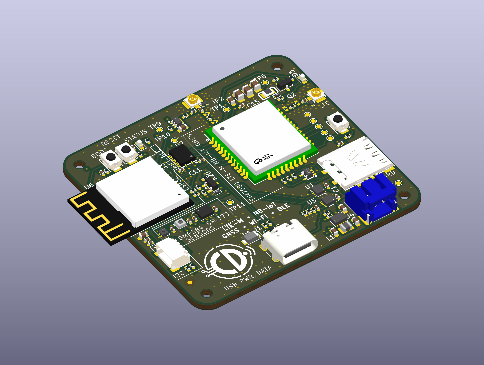
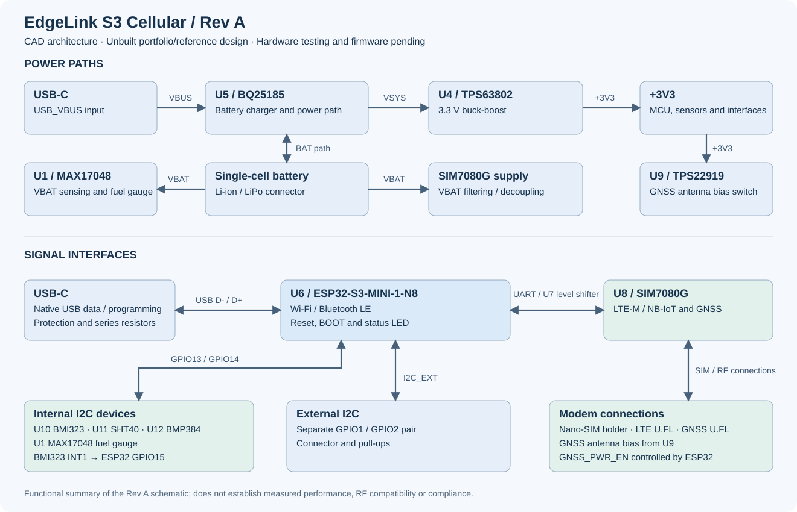
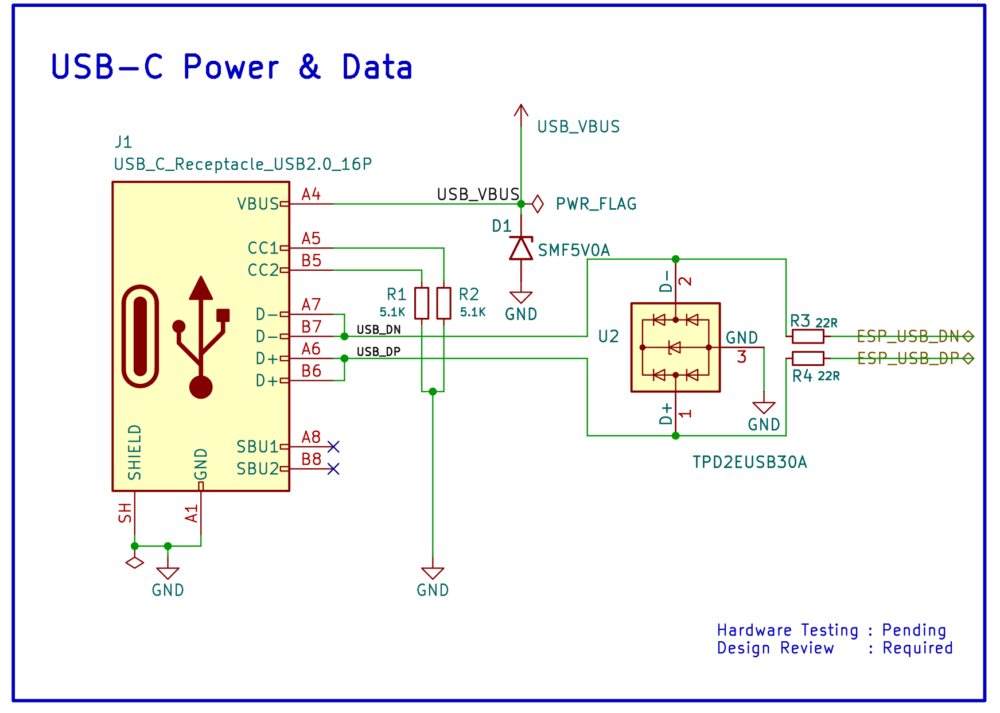
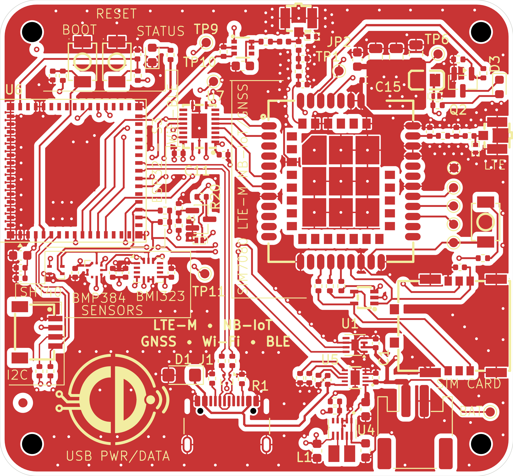
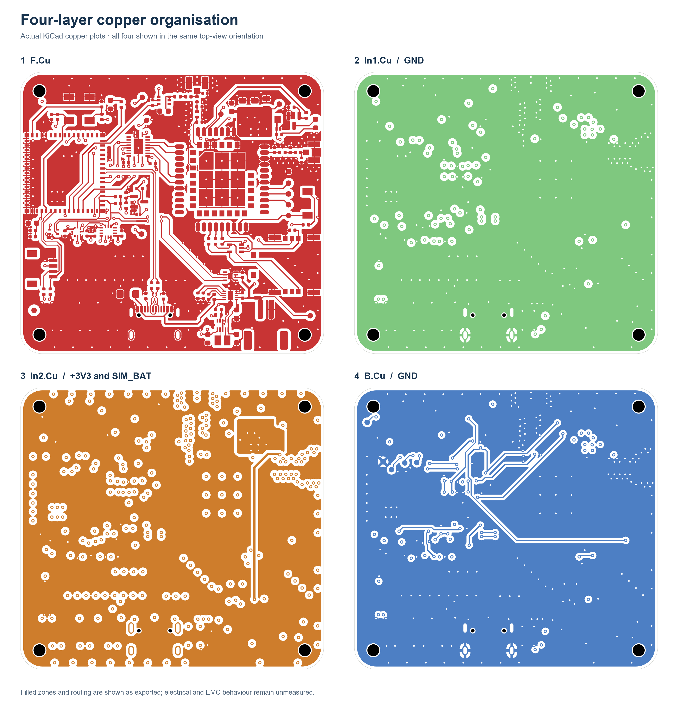

# EdgeLink S3 Cellular

**ESP32-S3 Embedded Hardware Design | LTE-M / NB-IoT | GNSS | Battery Power Management | Four-Layer PCB | KiCad**

## Engineering overview

EdgeLink S3 Cellular is a four-layer embedded hardware platform combining an ESP32-S3 controller, SIM7080G cellular/GNSS modem, USB-C, battery power management and environmental/motion sensing.

I developed the Rev A schematic and PCB as an engineering portfolio project, demonstrating system architecture, wireless module integration, power-tree design, digital interfaces, multilayer layout and manufacturing documentation.

**Project status:** The schematic, PCB and manufacturing package are complete as design deliverables. Rev A is an **unbuilt design**; hardware bring-up and physical performance testing have not been completed.

## Engineering portfolio — start here

| Resource | Contents |
| --- | --- |
| **[Illustrated engineering portfolio (PDF)](docs/portfolio/EdgeLink_S3_Cellular/EdgeLink_S3_Cellular_Engineering_Portfolio.pdf)** | Six-page visual case study with genuine PCB renders, schematic extracts and manufacturing evidence |
| [Editable portfolio (Word)](docs/portfolio/EdgeLink_S3_Cellular/EdgeLink_S3_Cellular_Engineering_Portfolio.docx) | Editable report |
| [Portfolio images](docs/portfolio/EdgeLink_S3_Cellular/images/) | PCB top/bottom views, four copper layers, circuit extracts and CAD renders |
| [System architecture](docs/images/architecture-reva.svg) | Functional system diagram |
| [Complete schematic PDF](docs/schematics/EdgeLink_S3_Cellular_RevA_Schematic.pdf) | Hierarchical schematic |
| [Editable KiCad project](hardware/kicad/EdgeLink_S3_Cellular_RevA/EdgeLink_S3_Cellular.kicad_pro) | PCB, schematic and supporting libraries |
| [Manufacturing package](manufacturing/REV_A/) | Gerbers, BOM and component placement |

## Hardware architecture

| Subsystem | Implementation |
| --- | --- |
| Controller | ESP32-S3-MINI-1-N8 with Wi-Fi/Bluetooth LE and native USB |
| Cellular and positioning | SIMCom SIM7080G LTE-M / NB-IoT and GNSS |
| Charging and power path | TI BQ25185 |
| 3.3 V regulation | TI TPS63802 buck-boost |
| Battery monitoring | MAX17048 fuel gauge |
| Motion sensing | Bosch BMI323 six-axis IMU |
| Environmental sensing | SHT40 temperature/humidity and BMP384 pressure |
| External interfaces | USB-C, Nano-SIM, LTE/GNSS U.FL, battery and I²C |

USB-C provides input power and native USB data. The BQ25185 manages the battery and system supply, while the TPS63802 generates the main 3.3 V rail. The cellular modem is powered from the battery supply through its input filtering. The sensor subsystem uses I²C connections to the ESP32-S3.

## Schematic engineering

The hierarchical schematic separates power and USB, ESP32-S3 processing, cellular/GNSS and sensor interfaces. Key circuits include battery charging and regulation, modem power and UART connectivity, RF antenna interfaces, USB-C protection and digital sensor integration.

## Four-layer PCB implementation

The Rev A PCB integrates power conversion, digital processing, wireless communications and sensors on a nominal 56 × 52 mm board. The layout uses four copper layers with local component decoupling and functional grouping of power, RF and digital circuitry.

Additional PCB views and genuine KiCad CAD renders are included in the [illustrated portfolio](docs/portfolio/EdgeLink_S3_Cellular/EdgeLink_S3_Cellular_Engineering_Portfolio.pdf).

## Manufacturing documentation

The Rev A package includes fabrication Gerbers, drill files, a supplier-oriented BOM with LCSC references and component placement data for JLCPCB-oriented assembly preparation.

The assembly BOM contains 46 component groups covering 89 fitted references, matched by the component placement list.

## Engineering capabilities demonstrated

- ESP32-S3 and wireless modem hardware integration
- USB-C and digital peripheral interfaces
- Battery charging, power-path and buck-boost architecture
- Four-layer PCB design and RF-aware placement/routing
- Hierarchical KiCad schematic capture and component libraries
- Supplier-oriented BOM, CPL and Gerber preparation
- Technical documentation and traceable engineering deliverables

## Repository guide

| Location | Contents |
| --- | --- |
| [Portfolio](docs/portfolio/EdgeLink_S3_Cellular/) | Illustrated PDF, Word report and supporting images |
| [KiCad source](hardware/kicad/EdgeLink_S3_Cellular_RevA/) | Editable design and local assets |
| [Architecture notes](docs/architecture/README.md) | Functional interfaces and power tree |
| [Manufacturing](manufacturing/REV_A/) | Fabrication and assembly files |
| [Verification records](docs/verification.md) | Detailed internal design-check documentation |
| [References](docs/references.md) | Manufacturer sources and CAD attribution |

**Tools:** KiCad 10, ESP32-S3 hardware design, wireless module integration, LCSC/JLCPCB-oriented manufacturing workflow and Git/GitHub.

No project-wide licence has been selected. Third-party assets retain their respective rights; see [references](docs/references.md).
