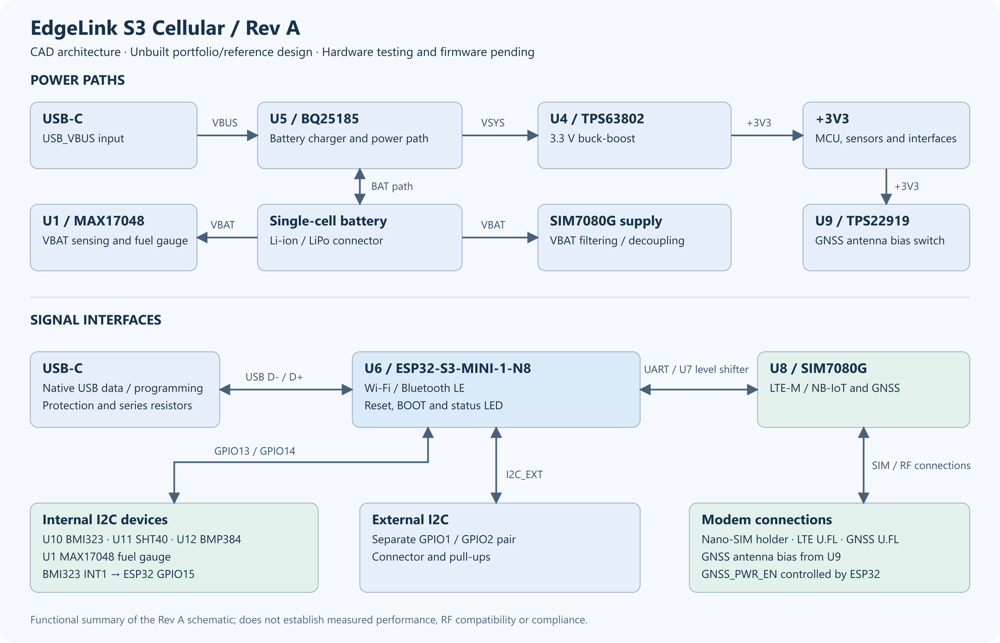
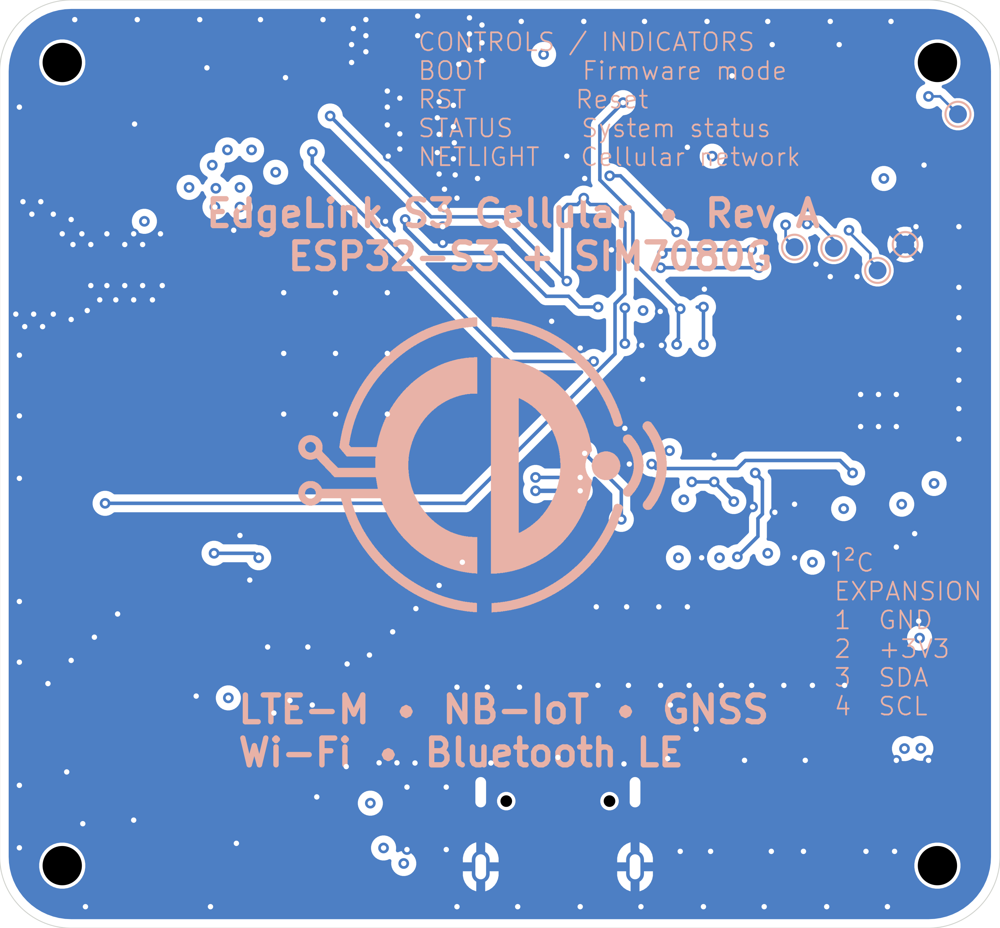
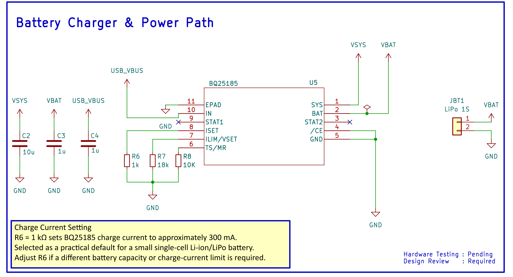

# EdgeLink S3 Cellular — Engineering Portfolio

**ESP32-S3 Embedded Hardware Platform | Four-Layer PCB | LTE-M / NB-IoT | GNSS | USB-C | Battery Management**

## Portfolio documents

- **[View the six-page engineering portfolio (PDF)](EdgeLink_S3_Cellular_Engineering_Portfolio.pdf)**
- [Editable engineering portfolio (Word)](EdgeLink_S3_Cellular_Engineering_Portfolio.docx)

This illustrated case study presents the architecture, schematic design, PCB layout and manufacturing documentation for the EdgeLink S3 Cellular Rev A hardware platform.

## Project at a glance

| Item | Description |
| --- | --- |
| Controller | ESP32-S3-MINI-1-N8 |
| Connectivity | SIM7080G LTE-M / NB-IoT, GNSS, Wi-Fi and Bluetooth LE |
| Power | USB-C, BQ25185 charging/power path, TPS63802 3.3 V buck-boost |
| Sensors | BMI323 IMU, SHT40 temperature/humidity, BMP384 pressure |
| PCB | Four layers, nominal 56 × 52 mm |
| Design environment | KiCad 10 |
| Deliverables | Schematic, PCB source, Gerbers, supplier BOM and placement data |
| Status | Rev A design documented; physical prototype and testing pending |

## Report contents

1. **Project overview** — platform goals and embedded hardware architecture.
2. **System architecture** — processing, power, wireless and sensor subsystems.
3. **Schematic design** — selected power, USB and interface circuits.
4. **PCB layout** — component placement, four-layer organisation and CAD renders.
5. **Manufacturing documentation** — fabrication and assembly preparation.
6. **Engineering capabilities** — transferable embedded hardware design skills.

## Selected design images

The [images directory](images/) includes additional genuine KiCad schematic exports, PCB plots and 3D CAD renders. These are representations of the design, not photographs of assembled hardware.

## Source design and manufacturing files

- [Editable KiCad project](../../../hardware/kicad/EdgeLink_S3_Cellular_RevA/EdgeLink_S3_Cellular.kicad_pro)
- [Complete schematic PDF](../../schematics/EdgeLink_S3_Cellular_RevA_Schematic.pdf)
- [Manufacturing package](../../../manufacturing/REV_A/)
- [Architecture documentation](../../architecture/README.md)

**Project status:** Rev A is an unbuilt engineering design. Fabrication, bring-up, performance measurements and regulatory evaluation have not been completed. Detailed source and verification records remain available in the repository.
