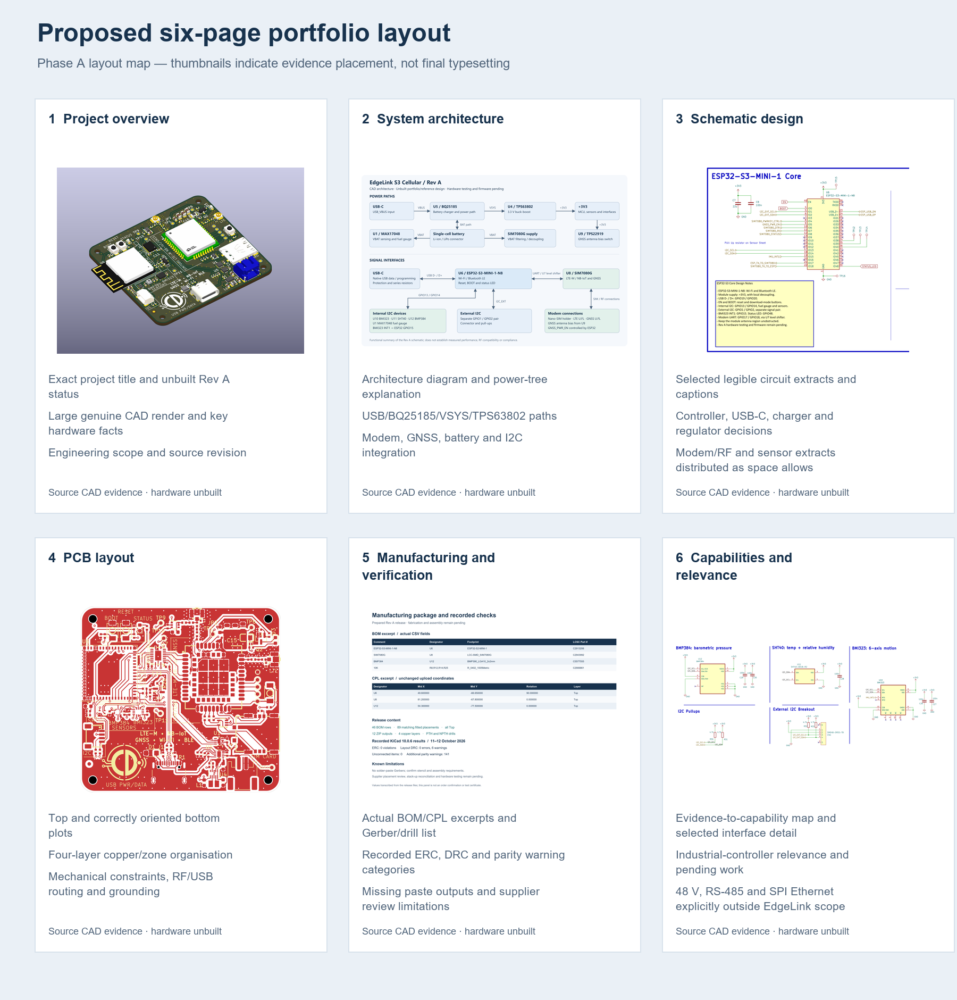

# EdgeLink S3 Cellular engineering portfolio preparation

**Phase A complete.** Genuine engineering images and a six-page report proposal
are prepared. The finished PDF and editable Word report will be created only
after approval of this evidence and layout. Nothing has been staged, committed,
pushed or published for this portfolio task.

## Source revision

- Repository: `CDonohoe-Designs/EdgeLink_S3_Cellular`
- Commit: `8bded932abc2eb7f814c76b664655bd760522112`
- Branch: `main`, tracking `origin/main`
- Initial working tree: clean
- Tool: KiCad 10.0.6
- Status: unbuilt Rev A engineering portfolio/reference design

Existing schematic/PCB/library/model and manufacturing files are preserved.
Exports and renders were made from a temporary project copy outside the
manufacturing release, with its design bytes checked against the working copy.

## Genuine CAD preview

This is a **KiCad CAD render of unbuilt hardware**, not a fabricated-board
photograph. Models, colours and visible component population follow the source
CAD/model display; the fitted BOM governs assembly. The high-quality detail view
is provided separately and intentionally does not show every board edge.

## Proposed six-page report

Title: **EdgeLink S3 Cellular — ESP32-S3 Embedded Hardware Platform**

Use A4 portrait, numbered headings, a black title, navy/teal accents, restrained
tables, figure captions and generous white space. Main text will be about
10.5–11 pt. Diagram sizing will prioritise readable electrical labels; only the
strongest excerpts will be placed in the six-page report rather than packing
every supplied image into small thumbnails. Full-resolution PNG/SVG assets remain
available for inspection. Power/RF/sensor excerpts may be distributed across the
architecture, schematic and capability pages to maintain legibility.

| Page | Focus | Evidence and narrative |
| --- | --- | --- |
| 1 | Project overview | Complete-board CAD render; four-layer, 56 × 52 mm design; ESP32-S3, SIM7080G, USB-C and battery integration; responsibilities and current status |
| 2 | System architecture | Existing architecture diagram; VBAT/VSYS/+3V3 relationships; modem, GNSS, fuel gauge, sensors and separate external I2C; selected power extracts where useful |
| 3 | Schematic design | Readable selected extracts of ESP32-S3, USB-C, BQ25185 and TPS63802; modem/RF and sensor/interface evidence; short explanations supported by source |
| 4 | PCB layout | Top/bottom plots, copper organisation, mechanical drawing and CAD detail; component/power/interface placement and routing considerations |
| 5 | Manufacturing and verification | Actual BOM/CPL sample rows; four copper layers, Gerber/drill package; all recorded warning categories and supplier limitations |
| 6 | Capabilities and industrial relevance | Evidence-to-skill mapping, digital-interface example, pending validation and explicit distinction from 48 V, RS-485 and SPI Ethernet |

The layout-map thumbnail is an approval aid, not a finished report or a schematic
legibility check at print scale. Word/PDF page layout and substantive-content
parity will be checked during Phase B.

## Evidence available

- Two genuine isometric renders: complete-board overview and high-quality detail.
- Top/bottom layout and separate F.Cu, In1.Cu, In2.Cu and B.Cu plots.
- Four-layer comparison, source stack-up diagram and mechanical geometry.
- Four full schematic page exports plus 15 focused circuit extracts.
- Existing architecture SVG and a 3960-pixel-wide PNG version.
- BOM/CPL/check-result panel constructed from actual project records.
- Native exported SVGs retained alongside high-resolution PNGs.

The 28 primary figures are mapped to source files in
[evidence_manifest.md](evidence_manifest.md). The complete pixel/hash inventory
and generation descriptions are in [generation_manifest.json](generation_manifest.json).

## Inspection findings

The board source contains 114 footprints: 89 fitted references, 16 test points,
four DNP capacitor references and five mechanical/graphic objects. Ninety-three
placed model references resolve with the installed standard models and local
assets. Source Edge.Cuts spans (44,48) to (100,100) mm, giving a nominal 56 × 52 mm
outline with a stored 4 mm corner radius. Four 2.2 mm NPTH mounting pads are
present; the release also includes two 0.65 mm USB connector holes.

The source contains GND zones on F.Cu, In1.Cu and B.Cu; In2.Cu contains +3V3 and
SIM_BAT supply zones. Those are CAD assignments, not proof of measured grounding,
power integrity, RF performance or EMC behaviour.

The assembly records parse to 46 BOM rows and 89 matching unique CPL references,
all Top, with no blank supplier codes. The existing ZIP opens, passes CRC and
contains 12 outputs matching the loose files byte-for-byte. The recorded KiCad
results are zero ERC violations, zero layout errors/unconnected items, six layout
warnings and 141 additional parity warnings. These are historical documented
checks; no new ERC/DRC/EMC/DFM qualification was performed for this image task.

## Required caveats in the final report

Fabrication, assembly, bring-up, application firmware, RF/sensor validation,
power testing, EMC/compliance and full DFM qualification remain pending.
The CAD is KiCad, not Altium. EdgeLink has no 48 V input protection, RS-485 or
SPI Ethernet implementation; those would be separate target-project work.

The manufacturing package has no solder-paste Gerbers. CAD settings are about
1.558 mm total, 1.238 mm core and finish None; nominal 1.6 mm, ENIG and
JLC04161H-3313 are intended supplier assumptions that require reconciliation.
U6 placement confirmation and physical footprint/model compatibility remain
review considerations. No controlled-impedance certification is claimed.

## Generation process

1. Read the root, architecture, verification, references and manufacturing notes.
2. Record the checked-out commit and hash all pre-existing working files.
3. Copy the current KiCad project and its local assets to a temporary workspace.
4. Export the layer plots and schematic pages using KiCad CLI; do not refill or
   overwrite the original board or manufacturing package.
5. Rasterise SVGs with aspect-preserving conversion; crop circuit regions by
   their source page coordinates. Bottom-side inspection uses KiCad's explicit
   mirror option; layer comparison uses a common unmirrored top orientation.
6. Render the copied PCB with KiCad's native 3D renderer and installed/local models.
7. Typeset mechanical, stack-up and manufacturing evidence from the source values.
8. Inspect images and verify existing file hashes, Git revision and branch remain unchanged.

The first 3D command rejected a leading-minus rotation argument. Using equivalent
315,0,35 rotation succeeded. The initial high-quality render was too tight for an
overview; it is labelled as a detail. A second wider render shows the entire board.
No fictional or stock PCB imagery is used.

## Phase B deliverables after approval

- `EdgeLink_S3_Cellular_Engineering_Portfolio.docx`
- `EdgeLink_S3_Cellular_Engineering_Portfolio.pdf`

Both will contain the same substantive content, the approved evidence and clear
unbuilt-design status. Every final page will be rendered and visually inspected.
No Git operation or GitHub publication is authorised by portfolio production.
